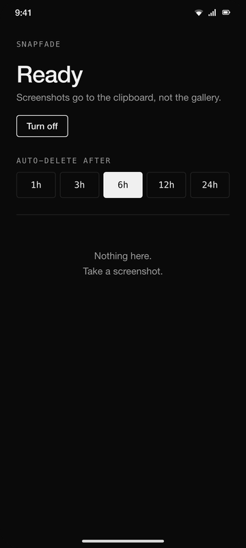
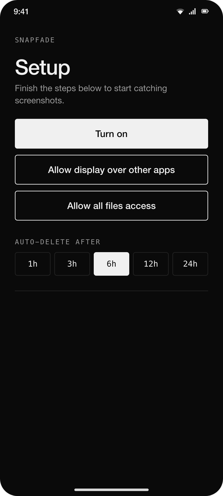
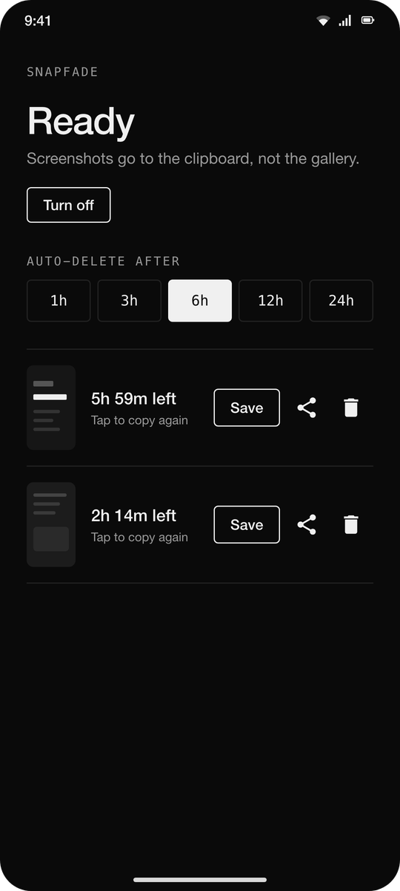
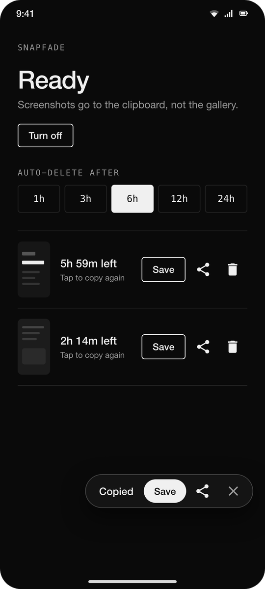

# SnapFade

**Temporary screenshots for Android.** Take screenshots the normal way (Power + Volume Down) and they go to your clipboard instead of cluttering your gallery. They self-destruct automatically unless you save them.

## Download

[**Download the latest APK**](https://github.com/C-P-S-P/SnapFade/releases/latest) — under 500 KB, Android 11+

## Screens

<p align="center">
  
</p>

| Setup | Ready | Popup |
|:-:|:-:|:-:|
|  |  |  |

## Why

Every screenshot you take gets saved permanently. Most are throwaway: a quick share, a reference, a one-time paste. SnapFade makes screenshots ephemeral by default and permanent only when you choose.

## Features

- **Default shortcut** — uses Power + Volume Down, no new gesture
- **Clipboard first** — screenshot goes straight to clipboard, gallery stays clean
- **Save popup** — tap Save to keep it permanently, or let it fade
- **Custom expiry** — auto-deletes after 1h / 3h / 6h / 12h / 24h
- **Share** — share directly from the app
- **In-app history** — see all screenshots with countdown timers, copy again, save, or delete

## Setup

1. Install the APK and open SnapFade.
2. Tap **Turn on**. This starts a small foreground service. Its notification is on a minimum-importance channel: no status-bar icon, no sound, hidden or collapsed into the shade's silent section depending on the OEM.
3. **Allow display over other apps:** for the Copied / Save popup. Without it you still get a toast.
4. **Grant "All files access":** needed to delete screenshots from the gallery without a confirmation dialog each time.

No accessibility service, no "restricted settings" dance. The main screen shows which steps are still missing, and the service restarts itself after a reboot.

## Build

```bash
# Requires JDK 17 and Android SDK 35
export JAVA_HOME=/opt/homebrew/opt/openjdk@17/libexec/openjdk.jdk/Contents/Home
./gradlew assembleDebug

# Install on connected device
adb install -r app/build/outputs/apk/debug/app-debug.apk

# Grant permissions via adb (skips the Settings round-trips)
adb shell appops set app.snapfade SYSTEM_ALERT_WINDOW allow
adb shell appops set app.snapfade MANAGE_EXTERNAL_STORAGE allow
```

**minSdk 30** (Android 11). Tested on vivo V2303 (Android 15, Funtouch 15).

## Architecture

```
ShotService (foreground Service, specialUse)
├── ContentObserver on MediaStore  → detects new screenshots
├── grab()                         → cache file, delete gallery copy, clipboard, schedule expiry
└── showOverlay()                  → TYPE_APPLICATION_OVERLAY popup at the bottom (Save / Share / dismiss)

BootReceiver           → restarts ShotService after reboot if the user turned it on

Shots (object)
├── copyToClipboard()  → FileProvider URI + grantUriPermission to systemui
├── share()            → ACTION_SEND intent with image URI
├── scheduleExpiry()   → WorkManager OneTimeWorkRequest per file (configurable TTL)
├── saveToGallery()    → MediaStore insert with IS_PENDING pattern
├── remove()           → delete + cancel worker + clear clipboard
└── sweep()            → delete all expired shots

ExpireWorker           → per-file worker, fires after configured expiry
MainActivity           → ListView of cached shots, live-refreshing via FileObserver
```

## Design decisions

- **MediaStore observer, not screenshot API:** Android doesn't let apps intercept Power+VolDown. The accessibility screenshot API (`takeScreenshot()`) requires a separate trigger. Watching MediaStore catches the result of the normal combo with ~1s latency.
- **Foreground service, not AccessibilityService:** v0.1–0.2 used an accessibility service to stay resident and draw the popup. That meant the Accessibility toggle plus the Android 13+ "restricted settings" hoop for sideloads. A `specialUse` foreground service with `SYSTEM_ALERT_WINDOW` does the same job with a plain "Turn on" button; the cost is one minimum-importance ongoing notification that most launchers don't even show.
- **`MANAGE_EXTERNAL_STORAGE`:** required to delete other apps' screenshots without per-file confirmation. Fine for sideloading; Google Play would reject this.
- **Per-file WorkManager jobs:** each screenshot gets its own timer. More precise than a single periodic sweep.
- **Overlay bottom-right:** pill ~110dp above the bottom edge, right-aligned, where the thumb already is. OEM screenshot previews (vivo, Pixel, Samsung) occupy the bottom-left, so the right side stays clear. `ShotService.OVERLAY_BOTTOM_DP` / `OVERLAY_END_DP` are the knobs.
- **R8 minification:** shrinks the APK from 7.4MB to under 500KB by stripping unused AndroidX classes.

## Limitations

- Sideload only. `MANAGE_EXTERNAL_STORAGE` won't pass Play Store review for this use case.
- Detection matches `RELATIVE_PATH LIKE '%Screenshot%'` or filenames starting with `Screenshot`. Covers stock Android, Samsung, Xiaomi, vivo. May need tuning for unusual OEMs.
- Pasting works in apps that accept image content (Gmail, WhatsApp, Telegram, Slack, Keep). Plain text fields ignore it.
- Background apps can't read the clipboard on Android 10+, so after expiry the clip entry may still appear but the backing file is gone.

## License

MIT
